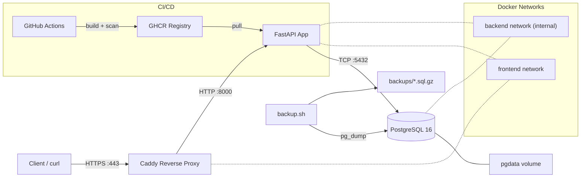

# Architecture

## System Diagram

## Network Segmentation

| Network | Services | Internal | Purpose |
|---|---|---|---|
| `frontend` | Caddy, App | No | Public-facing HTTPS traffic |
| `backend` | App, DB | **Yes** | Database traffic only; not reachable from outside |

The database container has **no published ports** and lives exclusively on the `backend` network (marked `internal: true`). Only the `app` service can reach it. Caddy is the sole entry point from outside.

## Least Privilege

- **Docker image**: Runs as non-root user `appuser`.
- **CI permissions**: `contents: read` and `packages: write` (only on push jobs).
- **Database**: Credentials are injected via environment variables, never committed.
- **Caddy**: Removes the `Server` header and adds security headers (HSTS, X-Frame-Options, etc.).

## Data Flow

1. Client sends HTTPS request to Caddy on port 443.
2. Caddy terminates TLS (self-signed via `tls internal`) and forwards to the FastAPI app on port 8000.
3. The app validates the JWT, processes the request, and interacts with PostgreSQL.
4. Audit events are written to the `audit_events` table for every state-changing operation.
5. Structured JSON logs are emitted to stdout with request ID, method, path, status, and latency.
